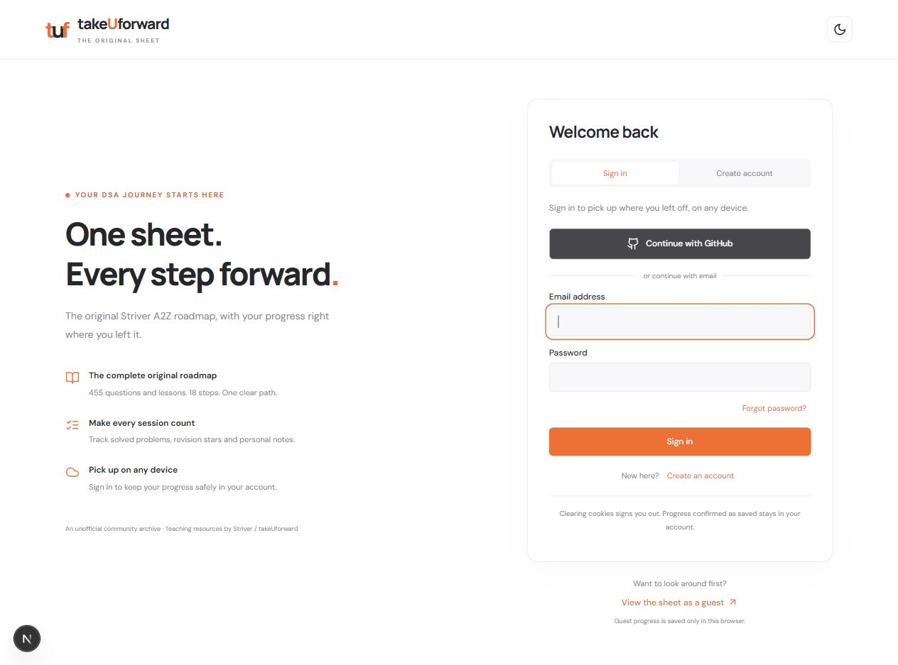

# Original A2Z

The classic orange Striver A2Z sheet, rebuilt with all **455 questions and lessons**, progress tracking, and cross-device saving.



## Features

- Original 18-step, 61-lecture roadmap with separate LeetCode, GFG, YouTube, and article links.
- Solved checkboxes, revision stars, personal notes, and section progress bars.
- Search, difficulty/status/platform filters, and a random unsolved-question picker.
- One login/signup page with email/password and GitHub OAuth, plus explicit guest access.
- Account progress saved to Postgres, with sync status, retries, and guest-progress import.
- JSON backups, dark mode, and responsive layouts.

## Stack and folders

```text
frontend/   Next.js + React + TypeScript; static frontend only
backend/    Node.js + Express + Better Auth; independent API
scripts/    Data generation, validation, and secret checks
research/   Historical sheet source, provenance, and screenshots
```

Supabase is used **only for PostgreSQL**. Authentication and all backend logic run in Node.js.

## Run locally

Requires Node.js 24.13+.

```bash
git clone https://github.com/divyamGNH/a2z.git
cd a2z
npm ci
cp frontend/.env.example frontend/.env
cp backend/.env.example backend/.env
```

Fill in `backend/.env` with your Postgres connection and a strong auth secret. GitHub login additionally needs your OAuth app client ID and secret.

Run in separate terminals:

```bash
npm run api:dev
```

```bash
npm run dev
```

Frontend: `http://localhost:3000` · API: `http://localhost:4000`

GitHub's local authorization callback is `http://localhost:4000/api/auth/callback/github`.

## Deploy

Each app has its own package file and lockfile.

| App | Suggested host | Root directory | Install | Build / Start |
| --- | --- | --- | --- | --- |
| Frontend | Vercel or any static host | `frontend` | `npm ci --workspaces=false` | `npm run build`; publish `out/` |
| Backend | Render or a Node host | `backend` | `npm ci --workspaces=false` | `npm start` |
| Database | Supabase Postgres | — | — | Use the session-pooler connection |

Set `NEXT_PUBLIC_API_URL` on the frontend before building. Keep database, session, OAuth, and SMTP secrets only on the backend. Use same-site HTTPS domains or an API proxy for login cookies. GitHub-only production login works without SMTP; email login, verification and password recovery require SMTP configuration.

On Vercel, use the **Other** framework preset for this static export. `frontend/vercel.json` supplies the build/output settings and clean URLs; keep Root Directory set to `frontend`.

See [setup and deployment details](docs/SETUP.md) for environment variables, OAuth, and hosting settings.

## Checks

```bash
npm test
npm run build
npm run check:client
npm run test:api
```

API tests create and remove their own disposable Postgres schema. Never commit `.env` files or `backend/storage/`.

## Credits

Curriculum and teaching resources belong to **Striver / takeUforward**. Historical data comes from [Bugaddr's archive](https://github.com/Bugaddr/a2z_old_sheet). This is an unofficial community recreation. Missing links stay blank; some archived URLs may have changed. See [research notes](research/analysis.md).
